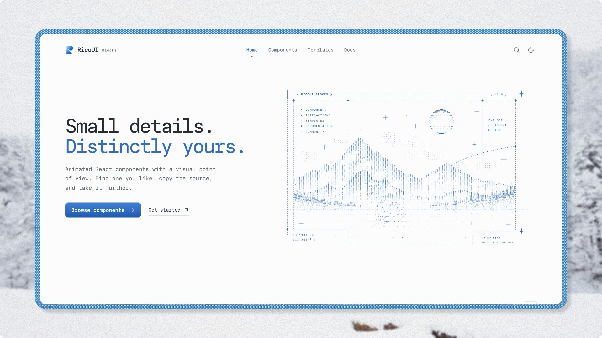

<div align="center">

# RicoUI Blocks

**A React + Tailwind component library focused on visual and interactive motion**

**English** | [简体中文](README.zh-CN.md)

<p>
  <a href="https://blocks.ricoui.com"></a>
  <a href="https://blocks.ricoui.com"></a>
  <a href="https://blocks.ricoui.com"></a>
  <a href="https://blocks.ricoui.com"></a>
  <a href="https://blocks.ricoui.com"></a>
  <a href="./LICENSE"></a>
</p>

</div>

RicoUI focuses on components, interactions and background effects with strong visual memorability for landing pages, portfolios, product showcases and AI product interfaces. Copy the source or install via the shadcn Registry — the component code lands directly in your project.



<small>Current version: V1.0</small>

[Website](https://blocks.ricoui.com) · [Components](https://blocks.ricoui.com/components) · [X @ricouii](https://x.com/ricouii)

## Why RicoUI?

- **Copy Source** — Not an npm dependency. Once installed, you own the code; modify it freely.
- **Visual memorability** — Rare but practical components: the Dither Pop halftone series, an optical magnifier, ASCII backgrounds, multi-curtain preloaders — not another set of basic controls.
- **Motion first** — Tactile interactions, inertial drag and sequenced animation. Motion / GSAP / Three.js are introduced per component and declared explicitly.
- **Zero runtime lock-in** — No dependency on shadcn/ui or TanStack Start. Works in any React + Tailwind project.
- **Accessible** — Keyboard operable, aria attributes, and sensible `prefers-reduced-motion` handling in motion components.
- **TypeScript** — Fully typed components with documented props.

RicoUI is not a replacement for foundational libraries like shadcn/ui — it complements them with strongly visual components they don't cover.

## Installation

Add any component via the shadcn CLI:

```bash
npx shadcn@latest add https://blocks.ricoui.com/r/flip-switch.json
```

Replace `flip-switch` in the URL with any component slug. You can also copy the source directly from the [components page](https://blocks.ricoui.com/components).

Third-party dependencies (such as `motion`, `gsap`) are declared automatically on install — nothing to wire up manually.

## Components

V1.0 ships 15 components across 5 categories:

| Category | Components |
| --- | --- |
| Dither Pop | File Organizer · Flip Switch · Dither Progress · GitHub Repo |
| Display | Magnifier · Contribution Graph · Empty States · Kubai Empty States · Social Card |
| Buttons | Button · Bell Button |
| Backgrounds | ASCII Background |
| Preloader | Popin · Clip Image · Step Overlap |

Previews, props, interaction details and source code for every component are on [blocks.ricoui.com](https://blocks.ricoui.com).

Dither Pop is an independent visual series: a halftone pop-art 2.5D vector illustration language with unified outlines, faceted lighting and tactile interaction. See [docs/dither-pop](docs/dither-pop/README.md).

## Development

### Requirements

- Node.js `>=22.12.0` (`.nvmrc` pins 22.23.3; run `nvm use` first if you use nvm)
- pnpm

### Local setup

```bash
git clone https://github.com/ricocc/ricoui-blocks.git
cd ricoui-blocks
pnpm install
pnpm dev
```

To enable GA4 locally, copy `.env.example` to `.env` and fill in `VITE_GOOGLE_ANALYTICS_ID` (loaded in production builds only).

### Project structure

```text
ricoui-blocks/
├── src/
│   ├── routes/           Website routes
│   ├── components/
│   │   ├── site/         Website UI
│   │   └── previews/     Component previews (not distributed)
│   ├── data/             Component metadata and mappings
│   └── lib/              Shared website logic
├── registry/             Distributable component source
├── public/r/             Registry JSON generated by shadcn build
├── docs/                 Project docs and Dither Pop specs
└── registry.json
```

### Available scripts

| Command | Description |
| --- | --- |
| `pnpm dev` | Start the local dev server |
| `pnpm build` | Production build with type checking |
| `pnpm preview` | Preview the build output |
| `pnpm deploy` | Build and deploy to Cloudflare Workers |
| `pnpm registry:validate` | Validate Registry configuration |
| `pnpm registry:build` | Generate `public/r/*.json` Registry files |

### Documentation

Read [`AGENTS.md`](AGENTS.md) before contributing, then refer to:

- [`docs/PROJECT-SPEC.md`](docs/PROJECT-SPEC.md) — Project specification
- [`docs/ARCHITECTURE.md`](docs/ARCHITECTURE.md) — Architecture
- [`docs/DEVELOPMENT.md`](docs/DEVELOPMENT.md) — Development workflow
- [`docs/COMPONENT-GUIDELINES.md`](docs/COMPONENT-GUIDELINES.md) — Component guidelines
- [`docs/dither-pop/DITHER-POP.md`](docs/dither-pop/DITHER-POP.md) — Dither Pop series spec

## Tech Stack

Website:

- TanStack Start
- React 19
- TypeScript
- Tailwind CSS 4
- Vite
- Cloudflare Workers

Components:

- React + Tailwind
- CSS first; Motion / GSAP / Three.js introduced as needed
- No shadcn/ui runtime dependency

Distribution:

- Copy Source
- shadcn Registry URL

## Feedback & Contributing

Report issues or suggest new component directions via [GitHub Issues](https://github.com/ricocc/ricoui-blocks/issues). New components follow the repository's fixed workflow and guidelines — see [Documentation](#documentation).

## License

- Project-owned code is released under the [MIT License](LICENSE), copyright `2026 RICOUI`; retain the copyright and license notice when using or distributing.
- Third-party code, fonts and assets keep their own licenses: the website TechText / PixelReveal use [MIT + Commons Clause](src/components/site/TECH-TEXT-LICENSE.md); local fonts follow the OFL; components rewritten from others' work such as `Kubai Empty States` carry Credits on their detail pages and follow the original licenses.

## Contact

- Updates and chat: [X @ricouii](https://x.com/ricouii)
- Personal site: [ricoui.com](https://ricoui.com)

---

<div align="center">


Built by [@ricouii](https://x.com/ricouii)

</div>
