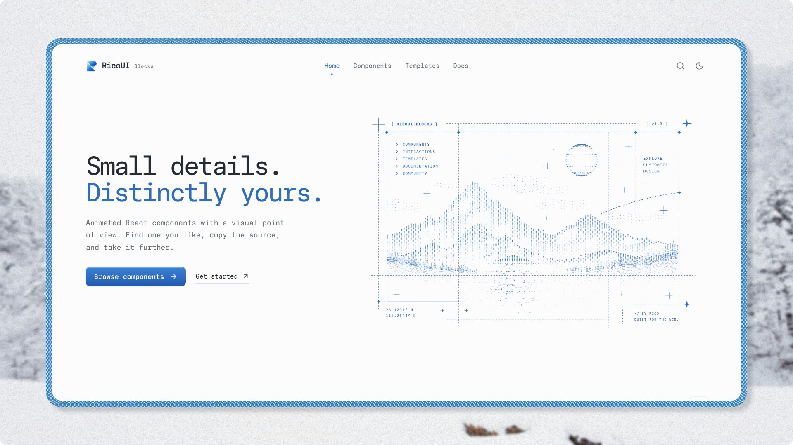

<div align="center">

# RicoUI Blocks

**专注于视觉和交互动画的 React + Tailwind 动效组件库**

[English](README.md) | **简体中文**

<p>
  <a href="https://blocks.ricoui.com"></a>
  <a href="https://blocks.ricoui.com"></a>
  <a href="https://blocks.ricoui.com"></a>
  <a href="https://blocks.ricoui.com"></a>
  <a href="https://blocks.ricoui.com"></a>
  <a href="./LICENSE"></a>
</p>

</div>

RicoUI 专注于落地页、作品集、产品展示与 AI 产品界面中具有明显视觉记忆点的组件、交互和背景效果。复制源码或通过 shadcn Registry 安装，组件代码直接进入你的项目。



<small>当前版本：V1.0</small>

[官网](https://blocks.ricoui.com) · [组件列表](https://blocks.ricoui.com/components) · [X @ricouii](https://x.com/ricouii)

## 为什么选择 RicoUI？

- **Copy Source** — 不是 npm 依赖。安装后源码归你所有，随意修改。
- **视觉记忆点** — 少见但实用的组件：Dither Pop 网点波普系列、光学放大镜、ASCII 背景、多层幕布 Preloader，而不是又一套基础控件。
- **动效优先** — 实体交互、惯性拖拽、序列动画，Motion / GSAP / Three.js 按组件需要引入，逐组件显式声明。
- **零运行时锁定** — 不依赖 shadcn/ui，不依赖 TanStack Start，任意 React + Tailwind 项目可用。
- **注重可访问性** — 键盘操作、aria 属性，动效组件合理处理 `prefers-reduced-motion`。
- **TypeScript** — 全部组件完整类型定义，Props 文档化。

RicoUI 不试图替代 shadcn/ui 等基础 UI 库，而是补足它们不覆盖的强视觉组件。

## 安装

通过 shadcn CLI 安装任意组件：

```bash
npx shadcn@latest add https://blocks.ricoui.com/r/flip-switch.json
```

把 URL 中的 `flip-switch` 换成任意组件 slug 即可。也可以直接在[官网组件页](https://blocks.ricoui.com/components)复制源码。

组件用到的第三方依赖（如 `motion`、`gsap`）会在安装时自动声明，无需手动处理。

## 组件

V1.0 收录 15 个组件，5 个分类：

| 分类 | 组件 |
| --- | --- |
| Dither Pop | File Organizer · Flip Switch · Dither Progress · GitHub Repo |
| Display | Magnifier · Contribution Graph · Empty States · Kubai Empty States · Social Card |
| Buttons | Button · Bell Button |
| Backgrounds | ASCII Background |
| Preloader | Popin · Clip Image · Step Overlap |

全部组件的 Preview、Props、Interaction Type 与源码见 [blocks.ricoui.com](https://blocks.ricoui.com)。

Dither Pop 是独立视觉系列：网点波普风格的 2.5D 矢量插画语言，统一描边、光影分面与实体交互，规范见 [docs/dither-pop](docs/dither-pop/README.md)。

## 开发

### 环境要求

- Node.js `>=22.12.0`（`.nvmrc` 固定为 22.23.3，使用 nvm 时先 `nvm use`）
- pnpm

### 本地启动

```bash
git clone https://github.com/ricocc/ricoui-blocks.git
cd ricoui-blocks
pnpm install
pnpm dev
```

如需本地接入 GA4，将 `.env.example` 复制为 `.env` 并填写 `VITE_GOOGLE_ANALYTICS_ID`（仅生产构建加载）。

### 目录结构

```text
ricoui-blocks/
├── src/
│   ├── routes/           官网路由
│   ├── components/
│   │   ├── site/         官网自身 UI
│   │   └── previews/     组件官网 Preview（不进入用户项目）
│   ├── data/             组件元数据与映射
│   └── lib/              官网共享逻辑
├── registry/             用户安装的真实组件源码
├── public/r/             shadcn build 生成的 Registry JSON
├── docs/                 项目文档与 Dither Pop 规范
└── registry.json
```

### 可用脚本

| 命令 | 说明 |
| --- | --- |
| `pnpm dev` | 启动本地开发服务器 |
| `pnpm build` | 构建生产版本并执行类型检查 |
| `pnpm preview` | 预览构建产物 |
| `pnpm deploy` | 构建并部署到 Cloudflare Workers |
| `pnpm registry:validate` | 校验 Registry 配置 |
| `pnpm registry:build` | 生成 `public/r/*.json` Registry 文件 |

### 开发文档

参与开发前先阅读 [`AGENTS.md`](AGENTS.md)，再按需查阅：

- [`docs/PROJECT-SPEC.md`](docs/PROJECT-SPEC.md) — 项目规格
- [`docs/ARCHITECTURE.md`](docs/ARCHITECTURE.md) — 架构
- [`docs/DEVELOPMENT.md`](docs/DEVELOPMENT.md) — 开发流程
- [`docs/COMPONENT-GUIDELINES.md`](docs/COMPONENT-GUIDELINES.md) — 组件规范与新增流程
- [`docs/dither-pop/DITHER-POP.md`](docs/dither-pop/DITHER-POP.md) — Dither Pop 系列规范

## 技术栈

网站：

- TanStack Start
- React 19
- TypeScript
- Tailwind CSS 4
- Vite
- Cloudflare Workers

组件：

- React + Tailwind
- CSS 优先，Motion / GSAP / Three.js 按需引入
- 不以 shadcn/ui 作为运行时依赖

分发：

- Copy Source
- shadcn Registry URL

## 反馈与贡献

欢迎通过 [GitHub Issues](https://github.com/ricocc/ricoui-blocks/issues) 报告问题或建议新组件方向。新增组件遵循仓库的固定流程与规范，见[开发文档](#开发文档)。

## License

- 项目自有代码采用 [MIT License](LICENSE)，版权归属 `2026 RICOUI`；使用或分发时保留版权和许可声明。
- 第三方代码、字体和资源保留各自授权：官网 TechText / PixelReveal 为 [MIT + Commons Clause 授权](src/components/site/TECH-TEXT-LICENSE.md)；本地字体遵循 OFL；`Kubai Empty States` 等基于他人作品重写的组件在详情页标注 Credits 并遵循原始授权。

## 联系

- 更新与交流：[X @ricouii](https://x.com/ricouii)
- 个人网站：[ricoui.com](https://ricoui.com)

---

<div align="center">


Built by [@ricouii](https://x.com/ricouii)

</div>
